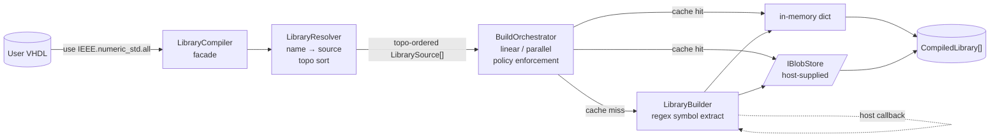
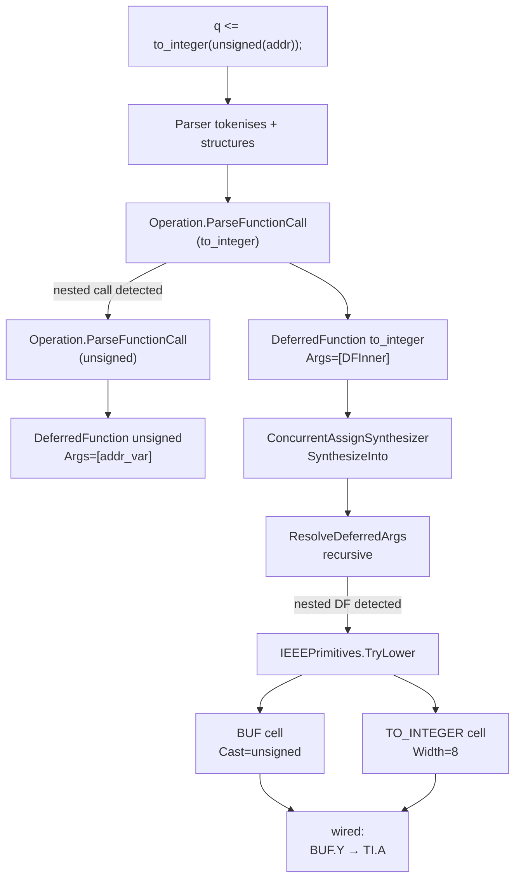
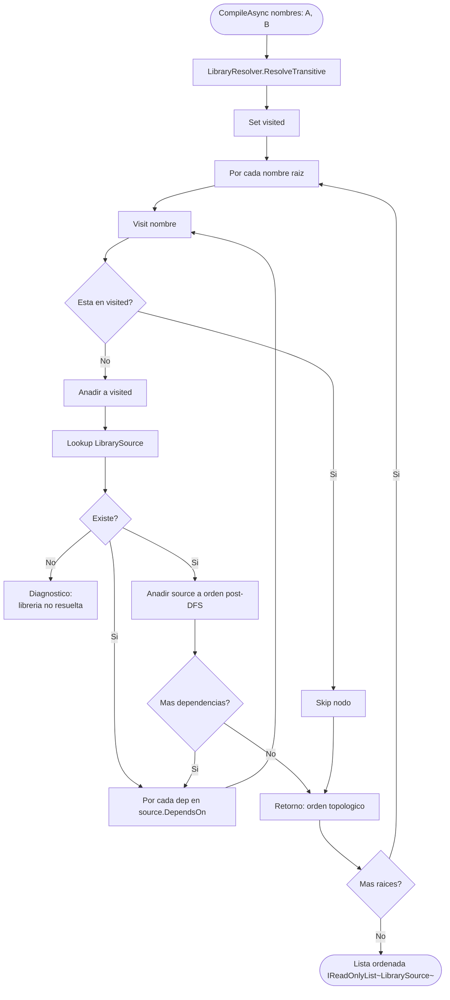
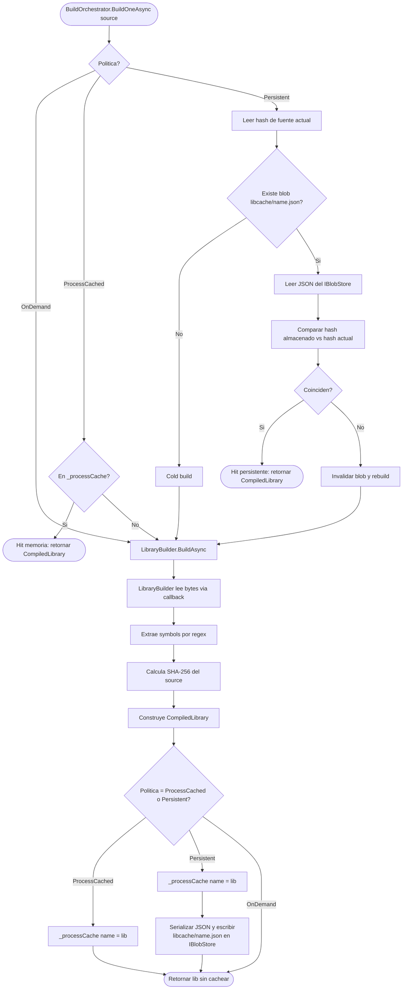
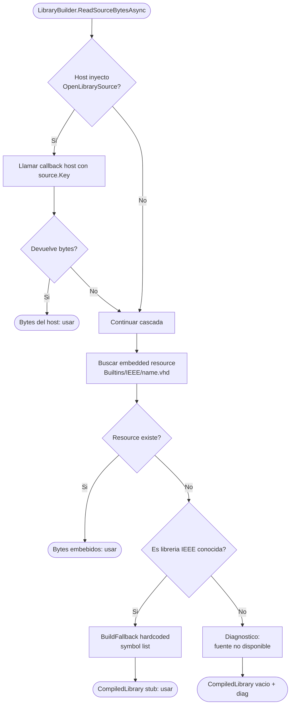

# LibraryCompiler

Library compilation as a sibling module of Parser / Interpreter / Debugger / TimeMachine. Owns the IEEE builtins, exposes a portable host-driven API, and produces compiled artifacts that the rest of the simulator (in particular `Interpreter.Synthesis.IEEEPrimitives`) consumes to lower IEEE function calls into real netlist primitives.

> **Status:** v1.19 (2 May 2026). Ships #22–#26 (extraction + policy + project + parallel + persistence) plus the IEEE primitive lowering pipeline added in #27–#29.

---

## Table of contents

1. [Design rule (hard)](#design-rule-hard)
2. [Quickstart](#quickstart)
3. [What the lib actually does](#what-the-lib-actually-does)
4. [Build-policy modes](#build-policy-modes)
5. [Linear vs Parallel orchestration](#linear-vs-parallel-orchestration)
6. [Persistent cache via IBlobStore](#persistent-cache-via-iblobstore)
7. [Multi-file projects](#multi-file-projects)
8. [User-imported libraries (plugins)](#user-imported-libraries-plugins)
9. [Integration with the Interpreter — IEEE primitive lowering](#integration-with-the-interpreter--ieee-primitive-lowering)
10. [Extending IEEEPrimitives](#extending-ieeeprimitives)
11. [Tests](#tests)
12. [Out of scope (host territory)](#out-of-scope-host-territory)

---

## Design rule (hard)

This module makes **zero** filesystem decisions. No `Environment.SpecialFolder`, no `AppContext.BaseDirectory` walking, no hardcoded `~/.kmila/`. Every path-related concern is injected by the host through `LibraryCompilerOptions`:

```csharp
public sealed record LibraryCompilerOptions(
    Func<string, CancellationToken, Task<Stream?>> OpenLibrarySource,
    IBlobStore? CacheStore = null,
    IReadOnlyList<LibrarySource>? AdditionalSources = null,
    LibraryBuildPolicy? Policy = null);
```

Same DI pattern that `JSONFileReader` / `Traductor` / `UserAssetStore` already use elsewhere in the simulator. The lib's constructor throws `ArgumentException` if `OpenLibrarySource` is null — there's no "default to current directory" fallback that could surprise a hosted environment.

---

## Quickstart

### Tests / CLI / one-off probes

```csharp
using LibraryCompiler.Services;
using LibraryCompiler.Repositories;

var compiler = LibraryCompiler.Services.LibraryCompiler.FromSyncOpener(
    openSync:    _ => null,                              // host returns no source
    cacheStore:  NullBlobStore.Instance,                 // no persistence
    policy:      LibraryBuildPolicy.AlwaysProcessCached);

// Resolves the user's `use IEEE.std_logic_1164.all` / `use IEEE.numeric_std.all`
// clauses, builds each library once, returns the artifacts.
IReadOnlyList<CompiledLibrary> libs =
    await compiler.CompileAsync(new[] { "std_logic_1164", "numeric_std" });

foreach (var lib in libs)
    Console.WriteLine($"{lib.LibraryName}: {lib.Functions.Count} symbols, hash {lib.ContentHash[..8]}");
```

### MAUI host wiring

```csharp
// In MauiProgram.CreateMauiApp() (HOST side — out of scope for this module)
builder.Services.AddSingleton<LibraryCompiler>(provider =>
{
    var policy = ProbeFreeRamAndPickPolicy();    // host's heuristic
    return new LibraryCompiler(new LibraryCompilerOptions(
        OpenLibrarySource: (key, ct) => FileSystem.OpenAppPackageFileAsync(key)
                                            .ContinueWith(t => (Stream?)t.Result, ct),
        CacheStore:        new MauiAppDataBlobStore(),    // host's IBlobStore impl
        AdditionalSources: provider.GetRequiredService<UserAssetStore>().ListUserLibrarySources(),
        Policy:            policy));
});
```

The lib never sees `FileSystem.AppDataDirectory` directly — the host wraps it inside the callback / blob store and hands those in.

---

## What the lib actually does



| Concern | Owner |
|---|---|
| Logical-name → source-key resolution + topo sort | `LibraryResolver` |
| Reading source bytes (host callback or embedded resource) | `LibraryBuilder.ReadSourceBytesAsync` |
| Linear vs Parallel orchestration | `BuildOrchestrator.BuildAsync` |
| In-memory artifact cache | `BuildOrchestrator._processCache` |
| Cache-policy enforcement (OnDemand / ProcessCached / Persistent) | `BuildOrchestrator.BuildOneAsync` |
| Persistence read/write (de)serialisation | `BuildOrchestrator.TryRead/WriteFromBlobAsync` |
| **Filesystem path / app-data directory decisions** | **HOST** (never the lib) |
| **Free-RAM heuristic that picks the default policy** | **HOST** (never the lib) |
| **User-plugin storage location & UI** | **HOST** (never the lib) |
| **Concrete `IBlobStore` implementations** | **HOST** (the lib only ships `InMemory` + `Null` reference impls) |

---

## Build-policy modes

```csharp
public enum LibraryBuildMode
{
    OnDemand,        // re-parse every call, drop after read
    ProcessCached,   // session-scoped in-memory retention
    Persistent       // session + IBlobStore round-trip
}

public sealed class LibraryBuildPolicy
{
    public LibraryBuildMode Default { get; init; } = LibraryBuildMode.ProcessCached;
    public IReadOnlyDictionary<string, LibraryBuildMode> PerLibrary { get; init; }
    public LibraryBuildMode ResolveFor(string libraryName) => …;
}
```

| Mode | RAM | Disk | When |
|---|:-:|:-:|---|
| **OnDemand** | re-parse every call, drop after read | none | low-RAM device; lots of one-off compiles |
| **ProcessCached** | session-scoped in-memory retention | none | typical interactive editor session (default) |
| **Persistent** | session + `IBlobStore` round-trip | host's call | desktop / dev workstation, repeated full-project builds |

### Per-library overrides

```csharp
var policy = new LibraryBuildPolicy
{
    Default    = LibraryBuildMode.OnDemand,        // tight RAM budget
    PerLibrary = new Dictionary<string, LibraryBuildMode>(StringComparer.OrdinalIgnoreCase)
    {
        ["std_logic_1164"] = LibraryBuildMode.ProcessCached,   // cache the hot one
        ["numeric_std"]    = LibraryBuildMode.ProcessCached,
        // every user plugin stays OnDemand by default
    }
};
```

Convenience constructors: `LibraryBuildPolicy.AlwaysOnDemand`, `AlwaysProcessCached`, `AlwaysPersistent`.

The lib does **not** pick the default for you. The host inspects the device (free RAM, disk quota, user setting) and chooses. If the host doesn't supply a policy, the lib defaults to `ProcessCached` — but emit a settings entry so the choice is auditable.

---

## Linear vs Parallel orchestration

```csharp
// Deterministic, single thread, topological order.
var libs = await compiler.CompileAsync(useClauses, BuildExecutionMode.Linear, ct);

// Concurrent, bounded by orchestrator.MaxParallelism (default = ProcessorCount/2).
// Output is sorted by library name on emit so diagnostics stay deterministic.
var libs = await compiler.CompileAsync(useClauses, BuildExecutionMode.Parallel, ct);
```

`MaxParallelism` defaults to `Environment.ProcessorCount / 2` to respect the workstation-GC budget set up in #7. Hosts can tighten or relax it:

```csharp
compiler.Orchestrator.MaxParallelism = 4;
```

Use linear mode for editor "single fixture" runs (deterministic, simpler diagnostic output). Use parallel mode for full-project builds where 5–10 user libraries + IEEE all need synthesis at once.

---

## Persistent cache via IBlobStore

The lib defines the **interface**, the host writes the **concretes**. This is the seam that keeps the lib portable across MAUI / Web / desktop.

```csharp
public interface IBlobStore
{
    Task<bool>          ExistsAsync(string key, CancellationToken ct);
    Task<byte[]?>       ReadAsync(string key, CancellationToken ct);
    Task                WriteAsync(string key, byte[] payload, CancellationToken ct);
    Task                DeleteAsync(string key, CancellationToken ct);
    IAsyncEnumerable<string> EnumerateKeysAsync(CancellationToken ct);
}
```

### Reference implementations the lib ships

| Class | Use |
|---|---|
| `InMemoryBlobStore` | tests, session-only persistence without disk |
| `NullBlobStore.Instance` | persistence disabled (singleton) |

### Concrete implementations the host writes

| Class (host) | Backing | Where |
|---|---|---|
| `FileSystemBlobStore(rootPath)` | OS filesystem | desktop / dev tree |
| `MauiAppDataBlobStore()` | `FileSystem.AppDataDirectory` | mobile / iOS / Android |
| `IsolatedStorageBlobStore()` | `IsolatedStorageFile` | sandboxed |

The lib uses a content-hash key (`libcache/<library_name>.json` containing the SHA-256 of the source) and JSON-serialised `CompiledLibrary` records. Eviction is the host's call — the lib emits enough information for the host to compute usage and delete entries; the size budget lives in host settings.

---

## Multi-file projects

```csharp
var ctx = new ProjectContext(
    Files:      new[] { "src/uart.vhd", "src/spi.vhd", "src/top.vhd" },
    UseClauses: new[] { "std_logic_1164", "numeric_std", "my_pkg" },
    TopEntity:  "top");

var project = await compiler.CompileProjectAsync(ctx);
// project.Libraries  → CompiledLibrary[] (IEEE + user libs)
// project.UserFiles  → pass-through to the existing Parser pipeline
// project.Diagnostics → aggregated lib-side warnings / errors
```

Real FPGA designs span many .vhd files. `CompileProjectAsync` is the editor's "Build" button entry point. The host pre-scans user files for `use` clauses (cheap regex), assembles a `ProjectContext`, and the compiler returns a unified result that feeds the existing Parser → Synthesizer pipeline.

---

## User-imported libraries (plugins)

The lib has no plugin path or convention. The host enumerates whatever it considers a "user library" and supplies the result through `LibraryCompilerOptions.AdditionalSources`:

```csharp
var custom = new LibrarySource(
    LibraryName: "my_crc",
    Vendor:      "WORK",
    SourceKey:   "/Users/me/Documents/Kmila/Plugins/my_crc/crc32.vhd",  // opaque to the lib
    DependsOn:   new[] { "numeric_std" });

var compiler = new LibraryCompiler(new LibraryCompilerOptions(
    OpenLibrarySource: (key, ct) => File.OpenRead(key) is var s ? Task.FromResult<Stream?>(s) : Task.FromResult<Stream?>(null),
    AdditionalSources: new[] { custom }));
```

Once registered, `use my_crc.crc32_pkg.all` resolves through the same machinery as IEEE.

---

## Integration with the Interpreter — IEEE primitive lowering

This is the fun part. v1.17–v1.19 wired the LibraryCompiler's symbol catalog into the Interpreter's synth path so IEEE function calls in user code emit **real netlist primitives**, not opaque placeholder constants.

### The pipeline



### What happens for `q <= to_integer(unsigned(addr))`

1. **Parser side** — `Operation.ParseFunctionCall("to_integer")` walks the args at depth 1. When it sees `unsigned` followed by `(`, it recursively calls itself to consume the nested call. The inner call returns a `DeferredFunction("unsigned", [addr_variable])`. The outer call's `Arguments == [DeferredFunction("unsigned", …)]` — no operand drop.

2. **DeferredFunction.ShouldDefer** — both `to_integer` and `unsigned` return `true`, so both stay structured (not inline-evaluated to literals). This is the change that made #29 possible.

3. **Runtime side** — `DeferredFunction.Evaluate()` recursively evaluates nested DFs to their `Variable` results, then hands those to `StandardFunctions.EvaluateFunction`. `to_integer(unsigned(addr))` now computes the correct integer for the bit pattern in `addr`.

4. **Synth side** — `ConcurrentAssignSynthesizer.ResolveDeferredArgs` recursively lowers nested DFs through `IEEEPrimitives.TryLower`. The inner `unsigned` lowers to a `BUF` cell with `Cast="unsigned"`; its output net becomes the input pin of the outer `TO_INTEGER` cell. Real wired netlist.

### Cell-kind table

| User VHDL call | Cell emitted | Notes |
|---|---|---|
| `rising_edge(clk)` | `EDGE_DETECT` (Edge=rising) | input pin CLK, output pin Y |
| `falling_edge(clk)` | `EDGE_DETECT` (Edge=falling) | |
| `to_integer(v)` (+ `conv_integer` alias) | `TO_INTEGER` | 32-bit output, `Width` attr |
| `to_unsigned(i, w)` | `TO_VECTOR` (Signed=false) | width-bus output |
| `to_signed(i, w)` (+ `conv_std_logic_vector` alias) | `TO_VECTOR` (Signed=true) | |
| `resize(v, n)` | `RESIZE` | `FromWidth` + `ToWidth` attrs |
| `shift_left(v, n)` / `shift_right(v, n)` | `SHL` / `SHR` | preserves operand width |
| `rotate_left(v, n)` / `rotate_right(v, n)` | `ROL` / `ROR` | |
| `unsigned(stdvec)` / `signed(stdvec)` / `std_logic_vector(...)` | `BUF` (Cast attr) | type-cast wires |

---

## Extending IEEEPrimitives

The primitive table lives at `Interpreter/Synthesis/IEEEPrimitives.cs`. Vendor libraries (e.g. Xilinx UNISIM, Intel Cyclone primitives) reuse the same machinery. To add a new primitive:

```csharp
internal sealed class MyAddSubPrimitive : IIEEEPrimitive
{
    public string CanonicalName => "addsub";
    public IReadOnlyList<string> Aliases => Array.Empty<string>();
    public CellKind PrimaryCellKind => CellKind.ADD;

    public IEEEPrimitiveResult Lower(IEEEPrimitiveArgs a)
    {
        if (a.Args.Count < 3) return new IEEEPrimitiveResult(a.Ctx.Constant("@addsub_arity", 1), 0);
        var lhs = a.Args[0]; var rhs = a.Args[1]; var sel = a.Args[2];
        var outNet = a.Ctx.NewInternal(width: lhs.Width, sourceLine: a.SourceLine);
        a.Ctx.AddCell(
            kind: CellKind.ADD,                       // would be a new CellKind.ADDSUB in real code
            inputs:  new[] { new Pin("L", lhs.Id), new Pin("R", rhs.Id), new Pin("SEL", sel.Id) },
            outputs: new[] { new Pin("Y", outNet.Id) },
            sourceLine: a.SourceLine,
            attrs:   new Dictionary<string, string> { ["Op"] = "addsub" });
        return new IEEEPrimitiveResult(outNet, 1);
    }
}

// At host startup (or vendor library init):
IEEEPrimitives.Register(new MyAddSubPrimitive());
DeferredFunction.ShouldDefer  // ← also extend if you want it deferred at parse time
```

Both `IEEEPrimitiveArgs` and the `IIEEEPrimitive` interface are `internal` because they reference the internal `SynthesisContext`. Vendor packs that need to register from outside the Interpreter assembly should add an `InternalsVisibleTo` attribute or live as a sub-namespace inside `Interpreter`.

---

## Tests

In-module: 17 cases in `Interpreter/Tests/LibraryCompilerTests.cs` exercise the full surface (resolver, builder, compiler, orchestrator, all 3 policy modes, per-library override, both blob stores, project compilation, reset).

Cross-cutting integration with the synth path:

| Suite | Cases | What it covers |
|---|---:|---|
| `IEEELibraryLoaderTests` | 6 | Legacy `IEEELibraryLoader` facade still seeds `FunctionRegistry` correctly |
| `IEEEPrimitivesTests` | 18 | Each emitter produces the right `CellKind` / width / attrs |
| `IEEELoweringEndToEndTests` | 6 | End-to-end: a hand-crafted DeferredFunction tree fed to the synthesizer produces the expected cells |
| `NestedIEEECallTests` | 7 | Parser nesting, runtime evaluation of nested calls (`to_integer(unsigned("01010101")) == 85`), synth wiring topology |

Run all of them:

```bash
cd Interpreter && dotnet bin/Debug/net9.0/Interpreter.dll --test-delta
```

Total Interpreter test count under `--test-delta`: **82 / 82**.

---

## Out of scope (host territory)

The contract is consistent: lib defines interfaces, host writes concretes. The following live in `Kmila.Shared/Services/` (or future host code), not in this module:

- Concrete `IBlobStore` implementations (`FileSystemBlobStore`, `MauiAppDataBlobStore`, `IsolatedStorageBlobStore`).
- "Import library" UI / `UserAssetStore.ListUserLibrarySources()` extension.
- Free-RAM probe that picks the default `LibraryBuildMode`.
- LRU eviction / quota policy for the persistent cache.
- Editor toggles for `--no-cache`, "Clear cache", `--build-mode linear|parallel`.

---

## Audit diagrams (2026-05-09)

These three diagrams were produced during the cross-module audit because the
LibraryCompiler module postdates TT1 and was previously absent from
`Documentacion/TT1/diagrams/`. Sources live there as
`fig_5_12_1_libcompiler_resolver_dag.mmd`, `fig_5_12_2_libcompiler_cache_roundtrip.mmd`,
`fig_5_12_3_libcompiler_source_cascade.mmd`.

### `fig_5_12_1_libcompiler_resolver_dag` — Topological dependency resolution



### `fig_5_12_2_libcompiler_cache_roundtrip` — Cache round-trip with hash invalidation



### `fig_5_12_3_libcompiler_source_cascade` — Three-tier source fallback



---

*Module added in v1.16. IEEE primitive lowering integration completed in v1.19. See [`Documentacion/CHANGELOG_v1.16.md`](../Documentacion/CHANGELOG_v1.16.md) … [`v1.19.md`](../Documentacion/CHANGELOG_v1.19.md) for the per-version detail.*
